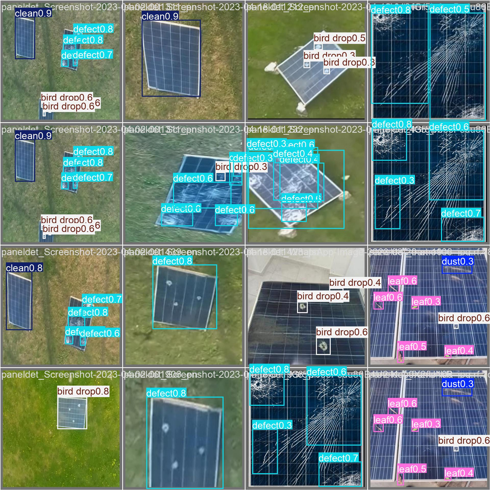
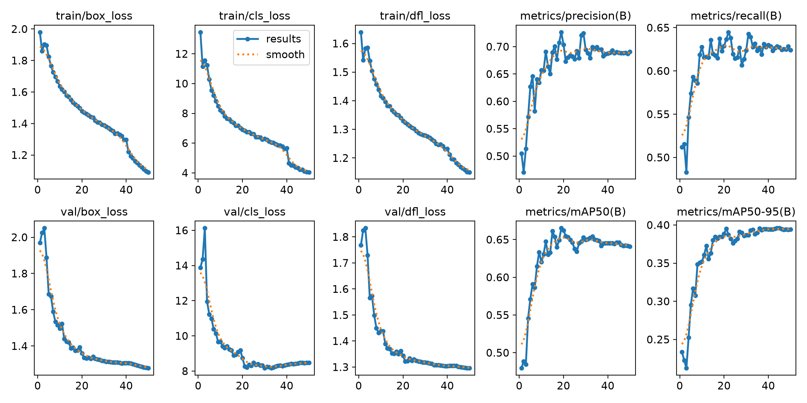
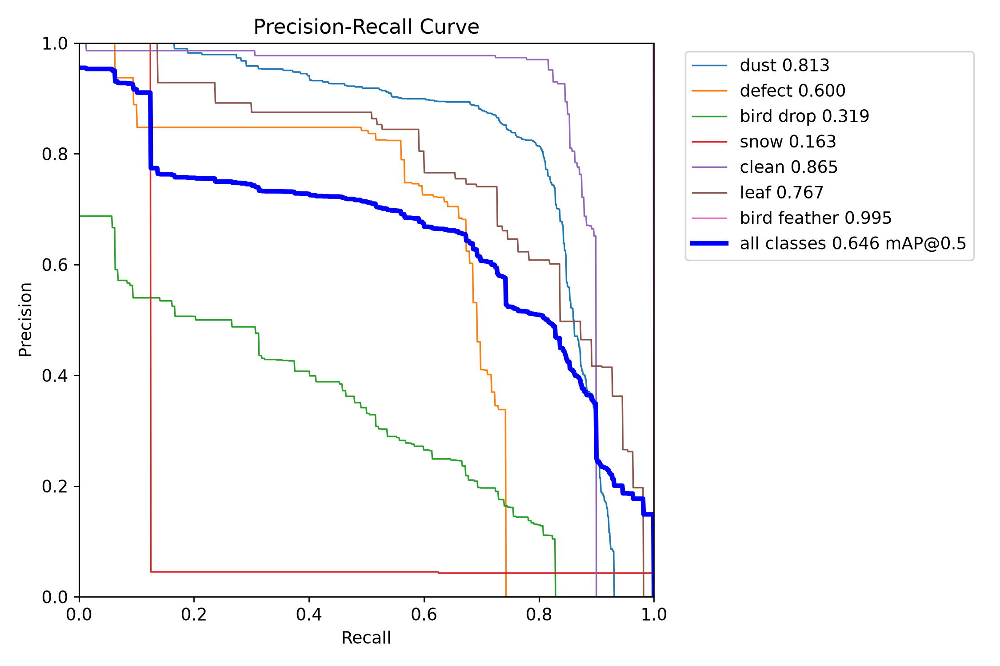
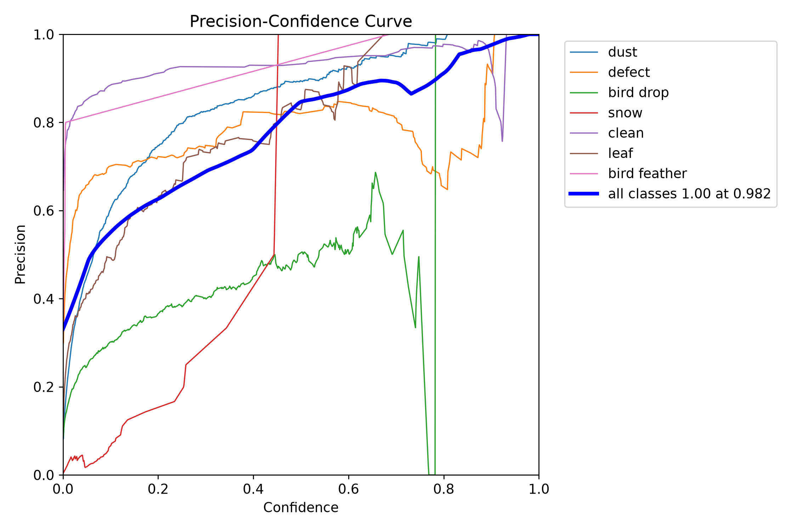

# ☀️ Solar AI: Multi-Source Defect & Soiling Detection with YOLOv11

[](https://www.python.org/)
[](https://pytorch.org/)
[](https://docs.ultralytics.com/)
[](LICENSE)

An end-to-end computer vision system engineered for automated condition assessment, defect segmentation, soiling detection, and contamination diagnosis on solar photovoltaic (PV) modules using state-of-the-art **YOLOv11**.

---

## 📑 Table of Contents
1. [Project Overview](#-project-overview)
2. [Unified Classes](#-unified-classes)
3. [Dataset Synthesis & `merged_dataset_v3` Statistics](#-dataset-synthesis--merged_dataset_v3-statistics)
4. [Data Cleaning & Auditing Pipeline](#-data-cleaning--auditing-pipeline)
   - [Duplicate Removal (Exact & Perceptual)](#1-duplicate-removal-exact--perceptual)
   - [Cross-Split Leakage Prevention](#2-cross-split-leakage-prevention)
   - [AI-Generated Image Auditing Model](#3-ai-generated-image-auditing-model)
5. [YOLOv11 Model Training (`solar_yolo11s_imbalanced`)](#-yolov11-model-training-solar_yolo11s_imbalanced)
6. [Experimental Results & Evaluation](#-experimental-results--evaluation)
   - [Validation Predictions (Batch 1 & Batch 2)](#validation-prediction-batches)
   - [Training Metrics & Progression](#training-metrics--progression)
   - [Confusion Matrix & PR Curves](#confusion-matrix--pr-curves)
7. [Installation & Quickstart](#-installation--quickstart)
8. [Repository Structure](#-repository-structure)

---

## 🔍 Project Overview

Photovoltaic module efficiency degrades significantly due to surface contamination (dust, bird droppings, fallen leaves, snow) and physical cell anomalies (cracks, hot spots, internal defects). This project integrates four distinct solar panel datasets into a unified benchmark (`merged_dataset_v3`), executes rigorous data sanitation (deduplication, leak prevention, and synthetic image auditing), and trains an imbalance-aware **YOLOv11s** model.

---

## 🏷️ Unified Classes

Heterogeneous multi-source label spaces were consolidated into 7 standardized target classes:

| Class ID | Class Name | Description |
| :---: | :--- | :--- |
| **0** | `dust` | Uniform/accumulated particulate soiling layer attenuating irradiance |
| **1** | `defect` | Structural damage, cell microcracks, discoloration, hotspots, delamination |
| **2** | `bird drop` | Concentrated organic deposits creating localized hotspots |
| **3** | `snow` | Partial or full module coverage by snow precipitation |
| **4** | `clean` | Clean solar module surface exhibiting baseline irradiance absorption |
| **5** | `leaf` | Organic debris, foliage, and vegetation shading module cells |
| **6** | `bird feather`| Fine organic particulates deposited on PV surface glass |

---

## 📊 Dataset Synthesis & `merged_dataset_v3` Statistics

The unified dataset `merged_dataset_v3` combines four source datasets:
1. `aerial_soiling/Soiling_DS_v2_14`
2. `6rainstorm final project.v1i.yolov11`
3. `Solar Panel Detection.v3i.yolov11`
4. `Solar-Panel-Dust-Detection.v2i.yolov11`

### Global Dataset Metrics (`dataset_statistics.json`)

| Metric | Count | Details |
| :--- | :---: | :--- |
| **Total Initial Discovered Images** | **24,257** | Raw pool across all 4 candidate datasets |
| **Corrupted / Invalid Files Excluded** | **1,893** | Unreadable files, zero-byte headers, missing extensions |
| **Exact Cryptographic Duplicates Removed** | **126** | Identical SHA-256 / MD5 redundant copies eliminated |
| **Cross-Split Data Leakage Prevented** | **2,122** | Images appearing across multiple splits isolated to prevent contamination |
| **Perceptual Near-Duplicate Pairs Identified** | **281,429** | Pairs with Hamming distance $\le 2$ flagged |
| **Annotation Conflicts Cataloged** | **153,817** | Co-located bounding box label discrepancies flagged |
| **AI Flagged for Review ($\ge 0.85$ Conf)** | **8,123** | Potential synthetic artifacts audited via ViT |
| **AI Uncertain ($0.50 \le \text{Conf} < 0.85$)** | **11,830** | Borderline AI probability scores |
| **AI Likely Real ($< 0.50$ Conf)** | **200** | High-certainty authentic camera captures |
| **Total Retained Images in Final Dataset** | **20,153** | Curated training/evaluation pool |

### Split Distribution

```
Total Curated Images: 20,153
├── Train Split : 19,451 images  (96.5%)
├── Valid Split :    383 images  ( 1.9%)
└── Test Split  :    319 images  ( 1.6%)
```

### Detailed Per-Source Dataset Breakdown

| Source Dataset | Initial Pool | Invalid Excluded | Exact Duplicates Removed | Cross-Split Leakage Fixed | AI Flagged (Conf $\ge 0.85$) | AI Uncertain | Total Retained | Splits (Train / Valid / Test) |
| :--- | :---: | :---: | :---: | :---: | :---: | :---: | :---: | :---: |
| `aerial_soiling/Soiling_DS_v2_14` | 302 | 0 | 40 | 0 | 1 | 243 | **262** | 217 / 22 / 23 |
| `6rainstorm final project.v1i.yolov11` | 3,592 | 1,590 | 0 | 56 | 383 | 1,485 | **1,946** | 1,591 / 170 / 185 |
| `Solar Panel Detection.v3i.yolov11` | 6,570 | 298 | 13 | 470 | 2,662 | 3,021 | **5,754** | 5,580 / 120 / 54 |
| `Solar-Panel-Dust-Detection.v2i.yolov11` | 13,793 | 5 | 73 | 1,596 | 5,077 | 7,081 | **12,191** | 12,063 / 71 / 57 |
| **Total Unified** | **24,257** | **1,893** | **126** | **2,122** | **8,123** | **11,830** | **20,153** | **19,451 / 383 / 319** |

---

## 🧹 Data Cleaning & Auditing Pipeline

### 1. Duplicate Removal (Exact & Perceptual)
To eliminate redundant frames, drone video stills, and web-scraped duplicates:
- **Exact Deduplication (SHA-256 / MD5)**: Computes full cryptographic digests for every image file. Identical copies are pruned while preserving the canonical primary image and mapping labels. **126 duplicate files across 124 distinct hash clusters** were pruned.
- **Perceptual Deduplication (dhash / phash)**: Computes 64-bit difference hashes (`dhash`) and perceptual hashes (`imagehash.phash`) by converting images to luminance gradients and calculating bitwise Hamming distance:
  $$\text{Hamming Distance}(h_1, h_2) = \sum (h_1 \oplus h_2)$$
  Pairs with distance $\le 2$ were identified (**281,429 pairs**), highlighting heavy oversampling in robotic/drone video sequences.

### 2. Cross-Split Leakage Prevention
In multi-source aggregations, identical or near-identical images often exist simultaneously in both training and test splits, causing severe evaluation over-optimism.
- The pipeline scans hashes across `train`, `valid`, and `test` splits.
- Any conflicting image found in validation or test is removed from the test/validation set or canonicalized strictly into the training split.
- **2,122 cross-split leakage instances** were resolved, ensuring the test and validation sets remain unseen benchmarks.

### 3. AI-Generated Image Auditing Model
To protect detection models against synthetic/diffusion artifacts:
- **Model**: [`dima806/ai_vs_real_image_detection`](https://huggingface.co/dima806/ai_vs_real_image_detection) (fine-tuned Vision Transformer - ViT).
- **Inference Strategy**: Extracts patch tokens and classifies probability $P(\text{AI})$.
  - `FLAGGED_FOR_REVIEW`: $P(\text{AI}) \ge 0.85$ (**8,123 images**)
  - `UNCERTAIN`: $0.50 \le P(\text{AI}) < 0.85$ (**11,830 images**)
  - `LIKELY_REAL`: $P(\text{AI}) < 0.50$ (**200 images**)
- **Retention Policy**: Quality auditing and tagging. To prevent dropping real-world anomalies that trigger false-positive AI flags (e.g. over-saturated thermal or drone aerial panels), images were retained in `merged_dataset_v3` with full audit logs generated in `reports/ai_generated_image_report.md`.

---

## 🚀 YOLOv11 Model Training (`solar_yolo11s_imbalanced`)

The model was trained on `merged_dataset_v3_balanced` with explicit countermeasures against class imbalance:
- **Architecture**: `YOLO11s` (Small, high-efficiency backbone with C3k2 and SPPF modules)
- **Input Resolution**: $640 \times 640$
- **Epochs**: 50
- **Batch Size**: 16
- **Optimizer**: Stochastic Gradient Descent with automated momentum (`momentum: 0.937`, `weight_decay: 0.0005`)
- **Learning Rate Schedule**: Initial $lr_0 = 0.01$, final $lr_f = 0.01$ with 3-epoch warmup
- **Imbalance Strategies**:
  - `cls` loss gain elevated to `2.0` (emphasizing classification precision over background)
  - `label_smoothing: 0.05` to prevent overconfidence on the dominant `dust` class
  - Copy-Paste augmentation (`copy_paste: 0.3`) to synthesize rare defect instances
  - Mosaic augmentation (`mosaic: 1.0`, `close_mosaic: 10` for the final 10 epochs)
  - Dynamic loss weighting hook injected via Ultralytics callbacks

---

## 📈 Experimental Results & Evaluation

### Training Metrics & Progression Summary

| Metric | Peak Value (Best Epoch) | Final Epoch (50) Value |
| :--- | :---: | :---: |
| **mAP@50 (B)** | **66.52%** (Epoch 19) | **64.07%** |
| **mAP@50-95 (B)** | **39.59%** (Epoch 45) | **39.45%** |
| **Precision (B)** | **72.64%** (Epoch 19) | **69.04%** |
| **Recall (B)** | **64.48%** (Epoch 22) | **62.44%** |
| **Validation Box Loss** | **1.2778** | **1.2778** |
| **Validation DFL Loss** | **1.2960** | **1.2960** |

---

### Validation Prediction Batches

Visual predictions on held-out validation samples showing bounding boxes, predicted defect classes, and prediction confidence scores:

#### Validation Batch 1 Predictions


#### Validation Batch 2 Predictions


#### Validation Batch 0 Predictions


---

### Training Metrics & Loss Curves

Overall convergence over 50 training epochs:



---

### Confusion Matrix & PR Curves

Detailed classification breakdown and precision-recall performance across all confidence thresholds:

| Normalized Confusion Matrix | Precision-Recall (PR) Curve |
| :---: | :---: |
|  |  |

| F1-Confidence Curve | Precision / Recall Curves |
| :---: | :---: |
|  |  |

---

## 💻 Installation & Quickstart

### 1. Clone & Environment Setup
```bash
git clone https://github.com/aayush2789/solar_ai_minor.git
cd solar_ai_minor

# Create virtual environment
python -m venv venv
source venv/bin/activate

# Install dependencies
pip install -r requirements.txt
```

### 2. Run Data Preprocessing & Deduplication
```bash
python preprocessing/run_preprocessing.py \
    --source /path/to/raw_solar_datasets \
    --output /path/to/processed_dataset
```

### 3. Train YOLOv11 with Imbalance Compensation
```bash
python train.py \
    --model yolo11s.pt \
    --data configs/data.yaml \
    --hyp configs/train_config.yaml \
    --epochs 50 \
    --batch 16 \
    --imgsz 640 \
    --class-weights smoothed \
    --name solar_yolo11s_imbalanced
```

### 4. Evaluate Checkpoints
```bash
python evaluate.py \
    --weights runs/detect/solar_yolo11s_imbalanced/weights/best.pt \
    --data configs/data.yaml \
    --split val
```

### 5. Run Inference on Images or Drone Footage
```bash
python predict.py \
    --weights runs/detect/solar_yolo11s_imbalanced/weights/best.pt \
    --source /path/to/solar_panel_images \
    --conf 0.25 \
    --save
```

---

## 📂 Repository Structure

```
solar_ai/
├── configs/
│   ├── data.yaml                     # Unified dataset configuration (7 classes)
│   └── train_config.yaml             # Tuned YOLOv11 hyperparameters
├── preprocessing/
│   ├── check_labels.py               # Label validation and bounding box sanity checks
│   ├── deduplicate.py                # MD5 exact and dhash perceptual deduplication
│   ├── rebalance.py                  # Offline targeted minority-class data augmentation
│   └── run_preprocessing.py          # Master dataset curation & merge pipeline
├── src/
│   ├── dataset_utils.py              # Class distribution counters and dataset inspection
│   └── train_utils.py                # Imbalance weighting (smoothed, effective, focal) & hooks
├── solar_yolo_11s_images/            # Validation prediction batches & metric plots
│   ├── val_batch0_pred.jpg
│   ├── val_batch1_pred.jpg           # Validation batch 1 predictions
│   ├── val_batch2_pred.jpg           # Validation batch 2 predictions
│   ├── results.png                   # 50-epoch loss and mAP progression curves
│   ├── confusion_matrix.png
│   ├── confusion_matrix_normalized.png
│   ├── BoxPR_curve.png               # Precision-Recall curve
│   ├── BoxF1_curve.png               # F1-confidence curve
│   ├── BoxP_curve.png                # Precision-confidence curve
│   └── BoxR_curve.png                # Recall-confidence curve
├── evaluate.py                       # Model evaluation script
├── predict.py                        # Batch and video inference script
├── train.py                          # Imbalance-aware YOLOv11 training pipeline
├── requirements.txt                  # Python dependencies
├── .gitignore                        # Excludes datasets, model weights, runs, secrets
└── README.md                         # Project documentation and benchmark report
```

---

## 📜 License
This project is licensed under the MIT License.
