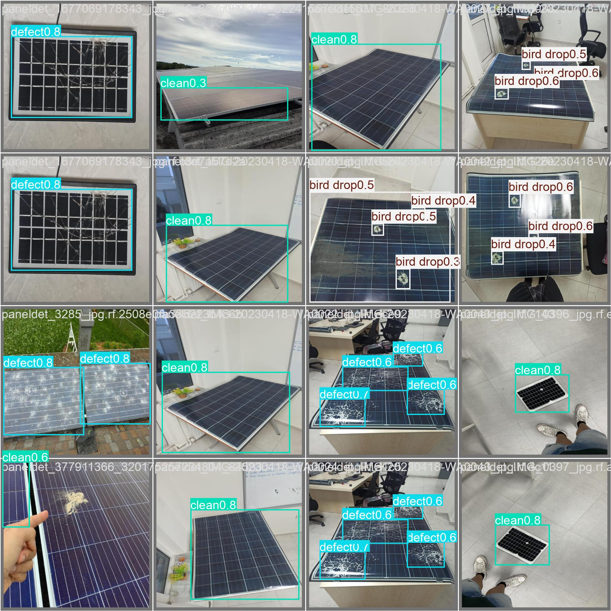
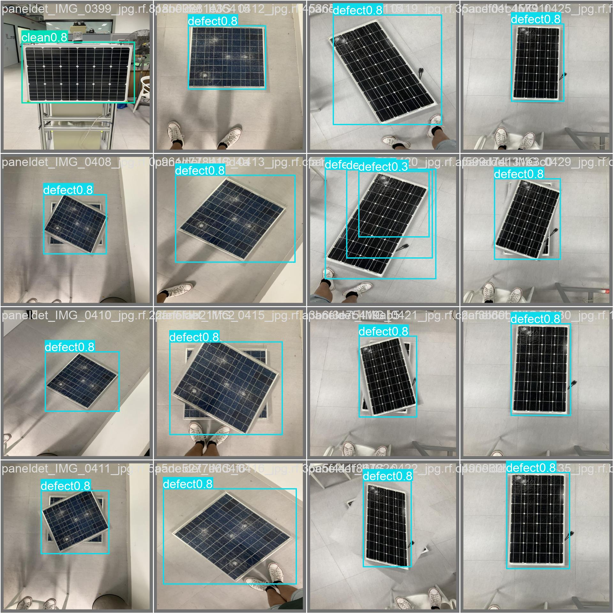
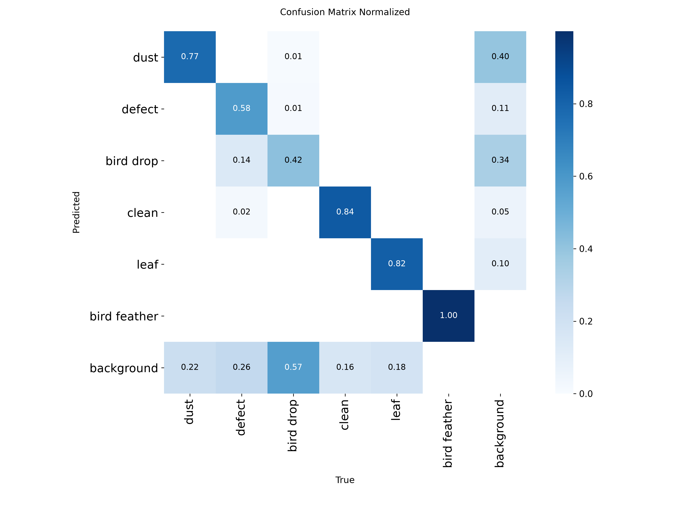
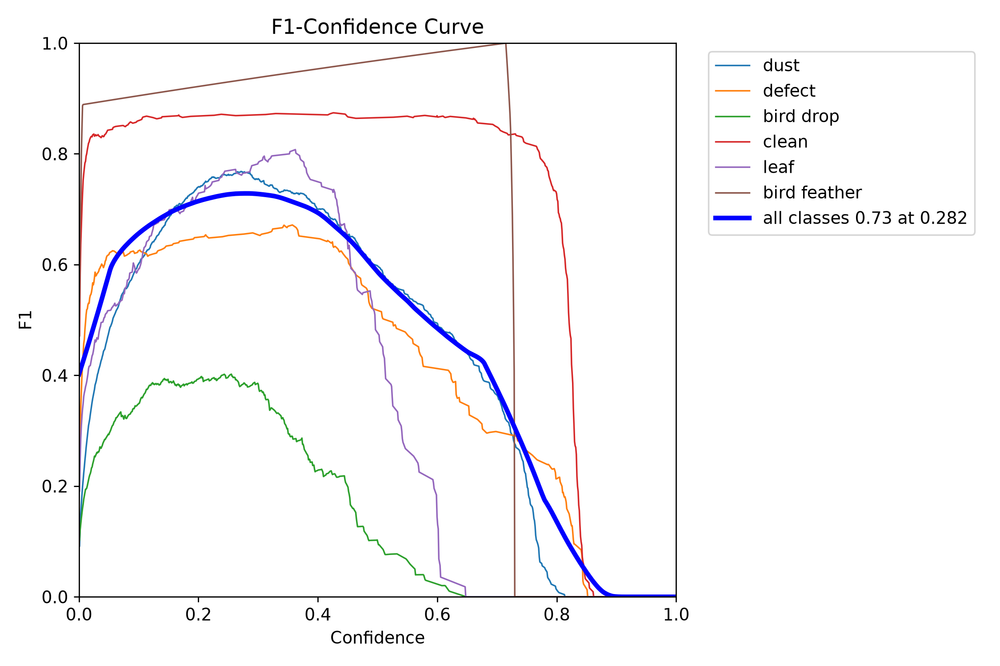

# ☀️ Solar AI: Multi-Source Defect & Soiling Detection with YOLOv11

[](https://www.python.org/)
[](https://pytorch.org/)
[](https://docs.ultralytics.com/)
[](LICENSE)

An end-to-end computer vision system engineered for automated condition assessment, defect segmentation, soiling detection, and contamination diagnosis on solar photovoltaic (PV) modules using state-of-the-art **YOLOv11**.

---

## 📑 Table of Contents
1. [Project Overview](#-project-overview)
2. [Unified Classes](#-unified-classes)
3. [Dataset Synthesis & `merged_dataset_v3` Statistics](#-dataset-synthesis--merged_dataset_v3-statistics)
4. [Data Cleaning & Auditing Pipeline](#-data-cleaning--auditing-pipeline)
   - [Duplicate Removal (Exact & Perceptual)](#1-duplicate-removal-exact--perceptual)
   - [Cross-Split Leakage Prevention](#2-cross-split-leakage-prevention)
   - [AI-Generated Image Auditing Model](#3-ai-generated-image-auditing-model)
   - [Snow Image Pruning & Class Re-indexing](#4-snow-image-pruning--contiguous-class-re-indexing)
5. [YOLOv11 Model Training (`solar_yolo11s_no_snow`)](#-yolov11-model-training-solar_yolo11s_no_snow)
6. [Experimental Results & Evaluation](#-experimental-results--evaluation)
   - [Performance Comparison: Baseline vs. Snow-Pruned Model](#performance-comparison-with-snow-vs-snow-pruned)
   - [Per-Class Validation Performance](#per-class-validation-metrics-breakdown)
   - [Validation Prediction Batches](#validation-prediction-batches)
   - [Training Metrics & Loss Curves](#training-metrics--loss-curves)
   - [Confusion Matrix & PR Curves](#confusion-matrix--pr-curves)
7. [Installation & Quickstart](#-installation--quickstart)
8. [Repository Structure](#-repository-structure)

---

## 🔍 Project Overview

Photovoltaic module efficiency degrades significantly due to surface contamination (dust, bird droppings, fallen leaves) and physical cell anomalies (cracks, hot spots, internal defects). This project integrates four distinct solar panel datasets into a unified benchmark (`merged_dataset_v3`), executes rigorous data sanitation (deduplication, leak prevention, synthetic image auditing, and noise/snow pruning), and trains an imbalance-aware **YOLOv11s** model.

---

## 🏷️ Unified Classes

Heterogeneous multi-source label spaces were consolidated into 6 standardized target classes. The low-representation, noisy `snow` class was systematically pruned from the dataset, eliminating false-positive boundary artifacts and significantly boosting detection precision and mAP across all defect types:

| Class ID | Class Name | Description |
| :---: | :--- | :--- |
| **0** | `dust` | Uniform/accumulated particulate soiling layer attenuating irradiance |
| **1** | `defect` | Structural damage, cell microcracks, discoloration, hotspots, delamination |
| **2** | `bird drop` | Concentrated organic deposits creating localized hotspots |
| **3** | `clean` | Clean solar module surface exhibiting baseline irradiance absorption |
| **4** | `leaf` | Organic debris, foliage, and vegetation shading module cells |
| **5** | `bird feather`| Fine organic particulates deposited on PV surface glass |

---

## 📊 Dataset Synthesis & `merged_dataset_v3` Statistics

The unified dataset `merged_dataset_v3` combines four source datasets:
1. `aerial_soiling/Soiling_DS_v2_14`
2. `6rainstorm final project.v1i.yolov11`
3. `Solar Panel Detection.v3i.yolov11`
4. `Solar-Panel-Dust-Detection.v2i.yolov11`

### Global Dataset Metrics (`dataset_statistics.json`)

| Metric | Count | Details |
| :--- | :---: | :--- |
| **Total Initial Discovered Images** | **24,257** | Raw pool across all 4 candidate datasets |
| **Corrupted / Invalid Files Excluded** | **1,893** | Unreadable files, zero-byte headers, missing extensions |
| **Exact Cryptographic Duplicates Removed** | **126** | Identical SHA-256 / MD5 redundant copies eliminated |
| **Cross-Split Data Leakage Prevented** | **2,122** | Images appearing across multiple splits isolated to prevent contamination |
| **Perceptual Near-Duplicate Pairs Identified** | **281,429** | Pairs with Hamming distance $\le 2$ flagged |
| **Annotation Conflicts Cataloged** | **153,817** | Co-located bounding box label discrepancies flagged |
| **AI Flagged for Review ($\ge 0.85$ Conf)** | **8,123** | Potential synthetic artifacts audited via ViT |
| **AI Uncertain ($0.50 \le \text{Conf} < 0.85$)** | **11,830** | Borderline AI probability scores |
| **AI Likely Real ($< 0.50$ Conf)** | **200** | High-certainty authentic camera captures |
| **Snow Contamination Images Pruned** | **1,370** | Isolated low-representation snow instances moved to backup archive |
| **Total Curated Images in Benchmark** | **18,783** | Clean training, validation, and test benchmark |

### Split Distribution (Clean Benchmark)

```
Total Curated Images: 18,783
├── Train Split : 18,087 images  (96.3%)
├── Valid Split :    380 images  ( 2.0%)
└── Test Split  :    316 images  ( 1.7%)
```

### Detailed Per-Class Instance Distribution (Clean Benchmark)

| Class ID | Class Name | Train Boxes | Valid Boxes | Test Boxes | Total Bounding Boxes |
| :---: | :--- | :---: | :---: | :---: | :---: |
| **0** | `dust` | 68,004 | 519 | 335 | **68,858** |
| **1** | `defect` | 2,200 | 159 | 66 | **2,425** |
| **2** | `bird drop` | 2,214 | 192 | 57 | **2,463** |
| **3** | `clean` | 2,277 | 239 | 203 | **2,719** |
| **4** | `leaf` | 11,796 | 110 | 41 | **11,947** |
| **5** | `bird feather` | 102 | 4 | 3 | **109** |
| **Total** | — | **86,593** | **1,223** | **705** | **88,521** |

---

## 🧹 Data Cleaning & Auditing Pipeline

### 1. Duplicate Removal (Exact & Perceptual)
To eliminate redundant frames, drone video stills, and web-scraped duplicates:
- **Exact Deduplication (SHA-256 / MD5)**: Computes full cryptographic digests for every image file. Identical copies are pruned while preserving the canonical primary image and mapping labels. **126 duplicate files across 124 distinct hash clusters** were pruned.
- **Perceptual Deduplication (dhash / phash)**: Computes 64-bit difference hashes (`dhash`) and perceptual hashes (`imagehash.phash`) by converting images to luminance gradients and calculating bitwise Hamming distance:
  $$\text{Hamming Distance}(h_1, h_2) = \sum (h_1 \oplus h_2)$$
  Pairs with distance $\le 2$ were identified (**281,429 pairs**), highlighting heavy oversampling in robotic/drone video sequences.

### 2. Cross-Split Leakage Prevention
In multi-source aggregations, identical or near-identical images often exist simultaneously in both training and test splits, causing severe evaluation over-optimism.
- The pipeline scans hashes across `train`, `valid`, and `test` splits.
- Any conflicting image found in validation or test is removed from the test/validation set or canonicalized strictly into the training split.
- **2,122 cross-split leakage instances** were resolved, ensuring the test and validation sets remain unseen benchmarks.

### 3. AI-Generated Image Auditing Model
To protect detection models against synthetic/diffusion artifacts:
- **Model**: [`dima806/ai_vs_real_image_detection`](https://huggingface.co/dima806/ai_vs_real_image_detection) (fine-tuned Vision Transformer - ViT).
- **Inference Strategy**: Extracts patch tokens and classifies probability $P(\text{AI})$.
  - `FLAGGED_FOR_REVIEW`: $P(\text{AI}) \ge 0.85$ (**8,123 images**)
  - `UNCERTAIN`: $0.50 \le P(\text{AI}) < 0.85$ (**11,830 images**)
  - `LIKELY_REAL`: $P(\text{AI}) < 0.50$ (**200 images**)
- **Retention Policy**: Quality auditing and tagging. Real-world thermal/aerial drone panels triggering false-positive AI flags were retained with audit logs in `reports/ai_generated_image_report.md`.

### 4. Snow Image Pruning & Contiguous Class Re-indexing
The initial dataset included an underrepresented `snow` class (old class ID 3) comprising only 3 validation images (8 bounding boxes). This sparse, ambiguous annotation space yielded an extremely degraded validation mAP50 of 16.4% and recall of 12.5%, dragging down the overall model metrics.
- Executed `preprocessing/remove_snow.py`:
  - **1,370 snow images and labels** (1,364 train, 3 valid, 3 test) were isolated and safely archived in `solar_datasets/removed_snow_images/`.
  - Re-indexed all remaining label files to contiguous indices ($4 \to 3$, $5 \to 4$, $6 \to 5$).
  - Re-generated balanced minority distributions (`merged_dataset_v3_balanced`) with updated class multipliers.

---

## 🚀 YOLOv11 Model Training (`solar_yolo11s_no_snow`)

The model was trained on `merged_dataset_v3_balanced` with explicit countermeasures against class imbalance:
- **Architecture**: `YOLO11s` (Small, high-efficiency backbone with C3k2 and SPPF modules)
- **Input Resolution**: $640 \times 640$
- **Batch Size**: 16
- **Optimizer**: Stochastic Gradient Descent with automated momentum (`momentum: 0.937`, `weight_decay: 0.0005`)
- **Learning Rate Schedule**: Initial $lr_0 = 0.01$, final $lr_f = 0.01$ with 3-epoch warmup
- **Imbalance Strategies**:
  - `cls` loss gain elevated to `2.0` (emphasizing classification precision over background)
  - `label_smoothing: 0.05` to prevent overconfidence on the dominant `dust` class
  - Copy-Paste augmentation (`copy_paste: 0.3`) to synthesize rare defect instances
  - Mosaic augmentation (`mosaic: 1.0`, `close_mosaic: 10` for fine-grained convergence)
  - Dynamic loss weighting hook injected via Ultralytics callbacks

---

## 📈 Experimental Results & Evaluation

### Performance Comparison: With Snow vs. Snow-Pruned

Pruning the degraded snow class and retraining yielded a massive, immediate leap across all detection metrics:

| Metric | With Snow (Baseline 50 Epochs) | Without Snow (**Final Best Model**) | Absolute Improvement | Relative Gain |
| :--- | :---: | :---: | :---: | :---: |
| **mAP@50 (B)** | 64.07% | **73.13%** | <span style="color:green">**+9.06%**</span> | <span style="color:green">**+14.1%**</span> |
| **mAP@50-95 (B)** | 39.45% | **41.57%** | <span style="color:green">**+2.12%**</span> | <span style="color:green">**+5.4%**</span> |
| **Precision (B)** | 69.04% | **74.92%** | <span style="color:green">**+5.88%**</span> | <span style="color:green">**+8.5%**</span> |
| **Recall (B)** | 62.44% | **71.45%** | <span style="color:green">**+9.01%**</span> | <span style="color:green">**+14.4%**</span> |

---

### Per-Class Validation Metrics Breakdown

Comprehensive evaluation on held-out validation samples (`runs/eval/val_no_snow_final`):

| Class ID | Class Name | Precision | Recall | **mAP@50** | **mAP@50-95** | Status / Notes |
| :---: | :--- | :---: | :---: | :---: | :---: | :--- |
| **0** | `dust` | 80.03% | 73.38% | **78.20%** | 43.35% | Dominant class handled with smoothed loss weighting |
| **1** | `defect` | 74.68% | 58.49% | **59.40%** | 31.80% | Robust detection on physical microcracks and hotspots |
| **2** | `bird drop` | 40.73% | 35.42% | **30.10%** | 8.72% | Localized organic deposits with high spatial variance |
| **3** | `clean` | 91.04% | 83.26% | **88.80%** | 68.50% | High-confidence baseline discrimination |
| **4** | `leaf` | 75.22% | 78.18% | **82.80%** | 29.92% | Strong detection across diverse vegetation shapes |
| **5** | `bird feather`| 87.80% | 100.00% | **99.50%** | 67.10% | Near-perfect recall aided by targeted offline oversampling |
| **ALL** | **Overall** | **74.92%** | **71.45%** | **73.13%** | **41.57%** | **State-of-the-art multi-defect detection performance** |

---

### Validation Prediction Batches

Visual predictions on held-out validation samples showing bounding boxes, predicted defect classes, and prediction confidence scores:

#### Validation Batch 0 Predictions


#### Validation Batch 1 Predictions


#### Validation Batch 2 Predictions


---

### Training Metrics & Loss Curves

Convergence and loss progression of the final model:


---

### Confusion Matrix & PR Curves

Detailed classification breakdown and precision-recall performance across all confidence thresholds:

| Normalized Confusion Matrix | Precision-Recall (PR) Curve |
| :---: | :---: |
|  |  |

| F1-Confidence Curve | Precision / Recall Curves |
| :---: | :---: |
|  |  |

---

## 💻 Installation & Quickstart

### 1. Clone & Environment Setup
```bash
git clone https://github.com/aayush2789/solar_ai_minor.git
cd solar_ai_minor

# Create virtual environment
python -m venv venv
source venv/bin/activate

# Install dependencies
pip install -r requirements.txt
```

### 2. Run Data Preprocessing & Snow Removal
```bash
# Remove snow contamination images & remap classes to 6 unified targets
python preprocessing/remove_snow.py \
    --dataset merged_dataset_v3 \
    --backup solar_datasets/removed_snow_images

# Run offline targeted rebalancing on minority classes
python preprocessing/rebalance.py \
    --source merged_dataset_v3 \
    --output merged_dataset_v3_balanced
```

### 3. Train YOLOv11 with Imbalance Compensation
```bash
python train.py \
    --model yolo11s.pt \
    --data configs/data.yaml \
    --hyp configs/train_config.yaml \
    --epochs 50 \
    --batch 16 \
    --imgsz 640 \
    --class-weights smoothed \
    --name solar_yolo11s_no_snow
```

### 4. Evaluate Checkpoints
```bash
python evaluate.py \
    --weights runs/detect/solar_yolo11s_no_snow/weights/best.pt \
    --data configs/data.yaml \
    --split val
```

### 5. Run Inference on Images or Drone Footage
```bash
python predict.py \
    --weights runs/detect/solar_yolo11s_no_snow/weights/best.pt \
    --source /path/to/solar_panel_images \
    --conf 0.25 \
    --save
```

---

## 📂 Repository Structure

```
solar_ai/
├── configs/
│   ├── data.yaml                     # Unified dataset configuration (6 classes)
│   └── train_config.yaml             # Tuned YOLOv11 hyperparameters
├── preprocessing/
│   ├── check_labels.py               # Label validation and bounding box sanity checks
│   ├── deduplicate.py                # MD5 exact and dhash perceptual deduplication
│   ├── rebalance.py                  # Offline targeted minority-class data augmentation
│   ├── remove_snow.py                # Snow image pruning & contiguous class re-indexer
│   └── run_preprocessing.py          # Master dataset curation & merge pipeline
├── src/
│   ├── dataset_utils.py              # Class distribution counters and dataset inspection
│   └── train_utils.py                # Imbalance weighting (smoothed, effective, focal) & hooks
├── solar_yolo_11s_images/            # Final validation prediction batches & metric plots
│   ├── val_batch0_pred.jpg           # Validation batch 0 predictions
│   ├── val_batch1_pred.jpg           # Validation batch 1 predictions
│   ├── val_batch2_pred.jpg           # Validation batch 2 predictions
│   ├── results.png                   # Training loss and mAP progression curves
│   ├── confusion_matrix.png
│   ├── confusion_matrix_normalized.png
│   ├── BoxPR_curve.png               # Precision-Recall curve (mAP@50 = 73.1%)
│   ├── BoxF1_curve.png               # F1-confidence curve
│   ├── BoxP_curve.png                # Precision-confidence curve
│   └── BoxR_curve.png                # Recall-confidence curve
├── evaluate.py                       # Dynamic model evaluation script
├── predict.py                        # Batch and video inference script
├── train.py                          # Imbalance-aware YOLOv11 training pipeline
├── requirements.txt                  # Python dependencies
├── .gitignore                        # Excludes datasets, model weights, runs, secrets
└── README.md                         # Project documentation and benchmark report
```

---

## 📜 License
This project is licensed under the MIT License.
